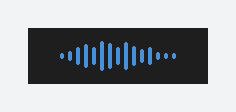
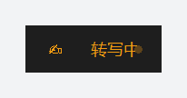
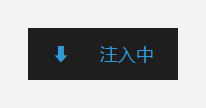
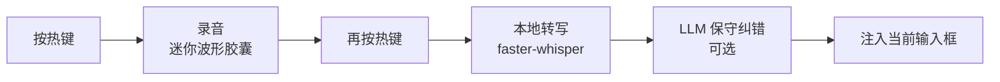
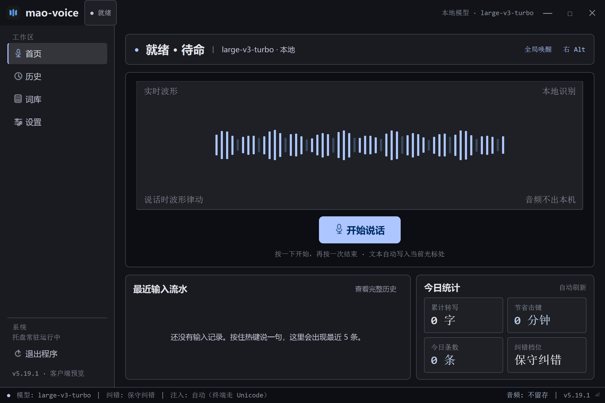
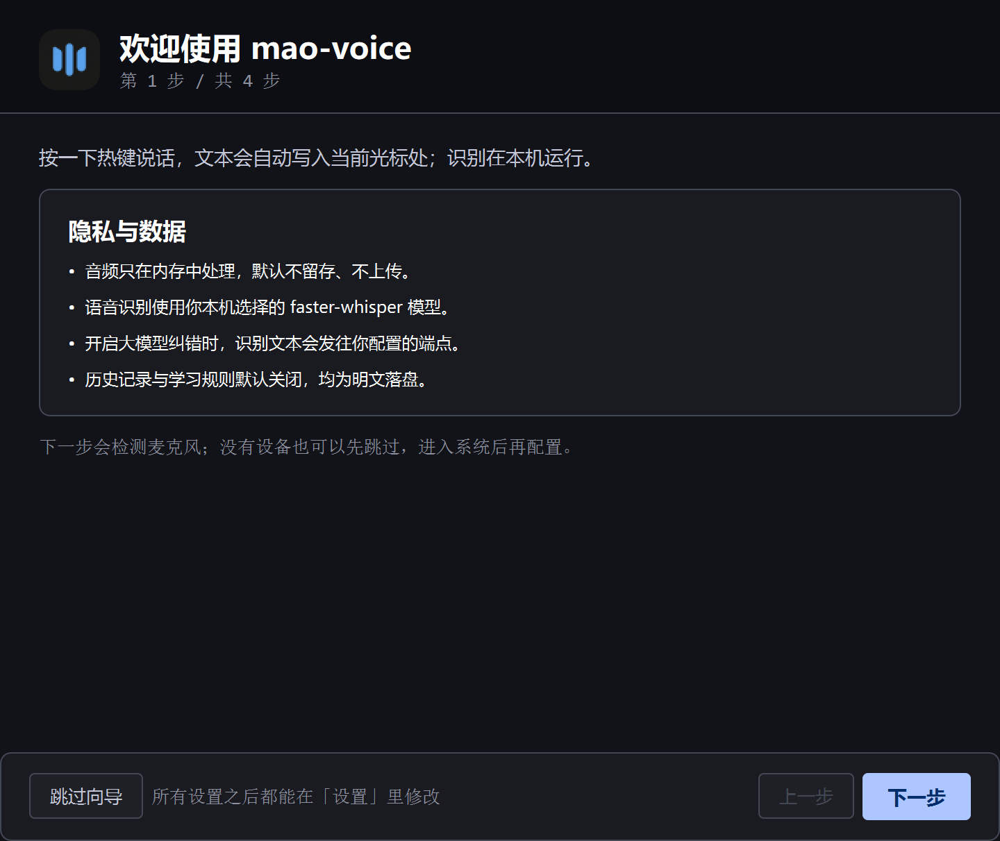
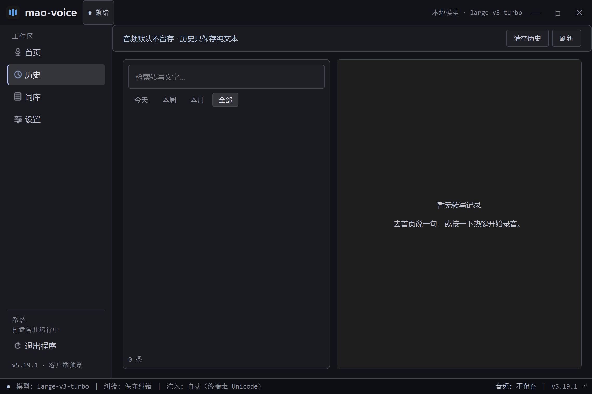
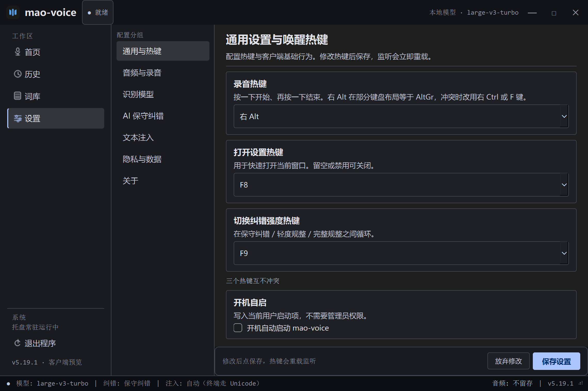
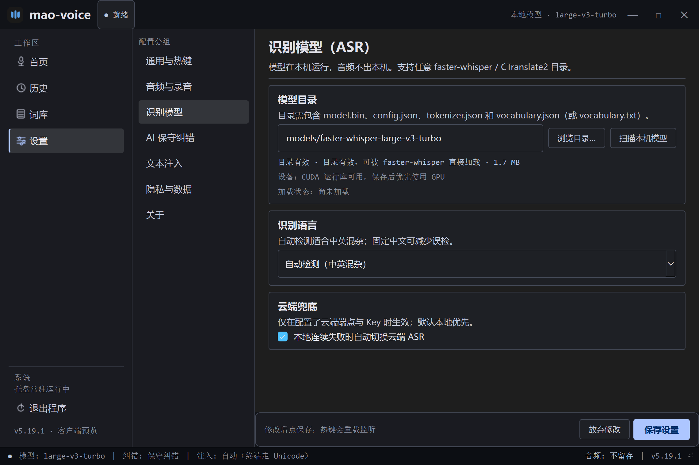
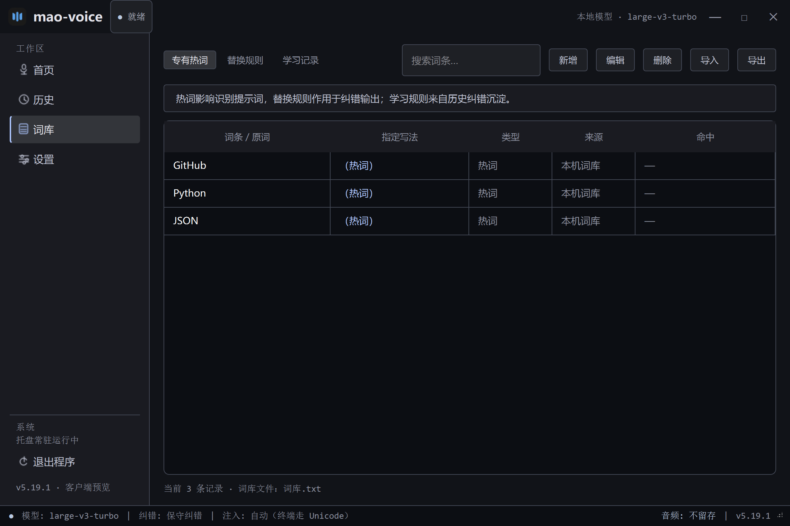

<p align="center">
  
</p>

<h1 align="center">mao-voice · AI 语音输入法</h1>

<p align="center">
  <b>简体中文</b> | <a href="./README_EN.md">English</a>
  <br><br>
  <a href="https://github.com/ChenChen913/mao-voice/actions/workflows/ci.yml"></a>
  <a href="https://github.com/ChenChen913/mao-voice/releases"></a>
  <a href="LICENSE"></a>
</p>

<p align="center">按一下热键开始录音，再按一下结束：本地 Whisper 识别 + 大模型保守纠错，干净文本直接注入当前输入框的 Windows 工具。</p>

> [!NOTE]
> 本项目由 AI 辅助开发（多 Agent 分模块实现，经多轮 AI 代码审查与三轮人工抽验）。主要逻辑已验证，但**未做完整的边界测试**。已知限制见下文，遇到问题欢迎提 Issue，请理解这是一个实验性项目。

## 演示

真实运行界面（非示意图）：录音中只显示声波，说完后依次显示「转写中 → 注入中」，文字直接落在光标处。

| 录音中 | 转写中 | 注入中 |
| --- | --- | --- |
|  |  |  |



## 目录

- [为什么做这个项目](#为什么做这个项目)
- [与同类工具的差别](#与同类工具的差别)
- [客户端预览（开发中）](#客户端预览开发中)
- [快速开始](#快速开始)
- [用法](#用法)
- [配置](#配置)
- [项目结构](#项目结构)
- [开发](#开发)
- [常见问题](#常见问题)
- [已知限制](#已知限制)
- [如何贡献](#如何贡献)
- [许可证与再分发](#许可证与再分发)

## 为什么做这个项目

说话比打字快，但现成语音输入工具的输出往往要再手动整理一遍：语气词、标点、谐音错字（如"配森"→Python）。

本项目的做法（动机与取舍源自 [PRD](docs/PRD_AI语音输入法.md) 与[调研文档](docs/AI语音输入法_调研与产品设计.md)）：

- **识别在本地**：faster-whisper 离线转写，GPU 加速，断网可用
- **保守纠错**：只修明显的识别错误（语气词/标点/谐音术语），不改写原意；三档强度可调
- **安全注入**：注入前完整备份剪贴板所有格式并恢复，UIPI 预检，检测外部修改；终端窗口自动改用 Unicode 直注
- **自学习纠错**：可选开启。润色差异中反复出现的"原词→修正"自动沉淀为规则，拼入后续提示词

**隐私边界（准确说法）**：

- 录音与语音识别全程在本机完成，**音频不上传**；
- 只有开启纠错（配置了 `refine.api_key`）时，**识别后的文本**会发送到你配置的 OpenAI 兼容端点（默认 DeepSeek）；
- 不填 Key 即纯本地、零联网；输入历史与学习规则默认关闭，开启后明文落盘（设置页有提示）。

## 与同类工具的差别

先说结论：这不是功能最全、也不是识别最准的方案，它的差异点在**注入链路的稳妥**与**可调**。

| 方案 | 形态 | 识别 | 交互与上屏 | 与本项目的差别 |
| --- | --- | --- | --- | --- |
| **mao-voice** | Windows 桌面工具 | 本地 faster-whisper（GPU/CPU 自动） | 按一下热键 toggle；剪贴板注入 + 终端 Unicode 直注 | 本仓库 |
| [CapsWriter-Offline](https://github.com/HaujetZhao/CapsWriter-Offline) | Windows 桌面工具（社区 7k+ star） | 本地 FunASR | 按住 CapsLock 说话、松开上屏；支持热词与 LLM 润色 | 更成熟、社区更大；本项目是 toggle 交互，多了保守纠错档位、注入安全与自学习规则 |
| 讯飞 / 搜狗等商业输入法 | 全平台输入法 | 云端为主 | 输入法内语音 | 免部署、识别强；需安装输入法，语音要上传云端 |
| 智谱 / 豆包 / Typeless 等 AI 输入法 | 桌面/移动 AI 输入法 | 云端 | 语音转写 + LLM 润色 | 体验完整但依赖订阅与网络；本项目可离线、可换模型与 API |

## 客户端预览（开发中）

除了托盘 + 热键的原有形态，仓库里新增了一个 PySide6 客户端外壳，视觉按 `code.html` 原型重做成深色仪表风：主窗口（首页 / 历史 / 词库 / 设置）、悬浮胶囊与托盘，直接复用现有引擎。

客户端已包含**首次启动向导**（隐私说明 / 麦克风试录 / 模型选择 / 热键与 Key，可跳过），**词库可新增、编辑、删除、导入导出**，**历史支持重新注入、删除与清空**，设置页可直接**浏览或扫描本机模型并校验四件套**。



<details>
<summary>更多界面：首次向导 / 历史 / 设置 / 模型设置 / 词库 / 录音胶囊</summary>












</details>

```powershell
cd voice_ime
python client_main.py     # 或双击 启动客户端.bat
```

当前状态：主窗口、托盘、胶囊与录音管线已接通；首次向导、词库增删改与历史操作已完成；设置页可保存并立即生效（模型切换重建引擎、热键重载监听、开机自启写入当前用户启动项），诊断信息可一键导出。按应用模式、统计页、更新检查与浅色主题仍属后续计划。Tk 版 `main.py` 仍是稳定入口，两者共用 `config.json`，请不要同时运行。

## 快速开始

### 方式一：免安装包（推荐给只想使用的用户）

从 [Releases](https://github.com/ChenChen913/mao-voice/releases) 下载 `mao-voice-windows-x64.zip`（CPU 版，CI 构建），解压后：

1. 把 `faster-whisper-small` 或 `medium` 模型目录放进解压目录的 `models/`（模型体积大，不打进安装包）；
2. 双击 `mao-voice.exe`，首次运行会生成 `config.json`；
3. 在 `config.json` 填 `refine.api_key`（可选），或设置 `DEEPSEEK_API_KEY` 环境变量；
4. 启动后按右 Alt 说话。

### 方式二：源码运行（开发/自定义）

前置要求：Windows 10/11、Python 3.10 及以上（CI 在 3.12/3.13 测试）、麦克风；（可选）NVIDIA GPU 与 CUDA 运行库。

```powershell
git clone https://github.com/ChenChen913/mao-voice.git
cd mao-voice/voice_ime
pip install -r requirements.txt
python download_model.py                # 下载模型（medium 约 1.5 GB，small 约 464 MB）
python doctor.py                        # 环境自检，全部 ✅ 后运行
python main.py                          # 或双击 启动.bat
```

> `config.json` 首次运行自动生成（等价于 `copy config.example.json config.json`）。模型从 ModelScope 下载（国内可达），也可 `python download_model.py --model small`。完整部署与 GPU 加速配置见[部署文档](docs/部署文档.md)。

## 用法

1. 打开任意可输入文字的窗口（记事本、聊天框、文档）
2. **按一下热键**（默认右 Alt）开始录音——屏幕底部中央出现迷你波形胶囊，不抢焦点
3. 说完**再按一下热键**结束——依次显示「转写中 → 注入中」，文字直接注入光标处
4. 退出：右键悬浮窗 → 退出，或托盘图标 → 退出

其他操作：`F8` 打开设置窗口（热键/模型/LLM/词库/历史），`F9` 循环切换润色强度，托盘图标随时查看状态。

不想装 Python 环境？`python packaging/build_exe.py` 可打包为免安装的 exe（详见[部署文档 §5.9](docs/部署文档.md)）。

## 配置

配置文件为 `voice_ime/config.json`（首次运行自动生成，原子写入）。常用项：

| 配置 | 必填 | 默认值 | 说明 |
|---------|------|--------|------|
| `refine.api_key` | 否 | 空 | DeepSeek 等 OpenAI 兼容 API Key。**按量计费**；不填则跳过纠错，直接输出原始转写 |
| `hotkey` | 否 | `alt_r` | 录音开关热键，支持 `alt_r`/`ctrl_r`/`f1`~`f12`/`caps_lock` 等 |
| `asr.model` | 否 | `models/faster-whisper-medium` | faster-whisper (CTranslate2) 模型目录，可指向任意本机 CT2 模型（需含 `model.bin`）；也可填 `small`/`medium` 让引擎自行下载 |
| `asr.language` | 否 | `null` | `null` 为自动检测（中英混杂友好），`"zh"` 固定中文 |
| `refine.level` | 否 | `conservative` | 纠错强度：`conservative`/`light`/`polish` |
| `inject.paste_mode` | 否 | `auto` | `auto` 下终端类窗口自动走 Unicode 直注；可强制 `ctrl_v`/`unicode` |
| `history.enabled` / `learn.enabled` | 否 | `false` | 输入历史 / 自学习纠错。两者都**明文落盘**，默认关闭 |

环境变量（config.py）：`DEEPSEEK_API_KEY`（纠错 Key 兜底）、`ASR_API_KEY`（云端 ASR Key 兜底）。

词库 `voice_ime/词库.txt`：每行一条热词，或 `原词=指定写法`（如 `配森=Python`），自动拼入识别与纠错提示词。

完整配置项说明见[部署文档 §5.4](docs/部署文档.md)。

## 项目结构

```text
mao-voice/
├── voice_ime/            # 运行时代码：24 个 Python 模块，约 6200 行
│   ├── main.py           # Tk 版入口：录音状态机 + 管线编排
│   ├── client_main.py    # Qt 客户端入口（预览）
│   ├── qt_ui/            # 主窗口 / 悬浮胶囊 / 托盘 / 引擎适配
│   ├── asr.py            # faster-whisper 引擎（GPU 优先，CPU 回退）
│   ├── safe_inject.py    # 剪贴板注入 + Unicode 直注
│   ├── learn.py          # 自学习纠错规则库
│   ├── version.py        # 版本号单一来源
│   ├── models/           # 本地模型（不入库）
│   └── tests/            # pytest 单测（128 项）+ 真机冒烟脚本
├── packaging/            # PyInstaller 打包脚本与图标
├── docs/                 # 部署文档、PRD/SPEC/调研、审核报告、演示截图
└── .github/workflows/    # CI 测试 + tag 触发打包发布
```

## 开发

```powershell
python -m pytest voice_ime/tests -q     # 运行测试（2026-11-01 实测 134 passed）
python -m ruff check voice_ime          # 静态检查（CI 同款）
python -m compileall -q voice_ime       # 语法检查
python voice_ime/tests/e2e_live.py --no-asr   # 真机冒烟：注入 + 剪贴板恢复（不需要模型）
python voice_ime/tests/e2e_live.py      # 完整真机冒烟：TTS → 本地 ASR → 注入（需模型）
python voice_ime/tests/client_smoke.py  # Qt 客户端 + 引擎冒烟（假录音/假注入）
python voice_ime/client_main.py         # 启动 Qt 客户端（预览）
python packaging/build_exe.py           # 打包 Tk 版 exe
python packaging/build_exe.py --client  # 打包 Qt 客户端 exe（预览）
```

- 推送到 GitHub 自动跑测试 CI（Windows + Python 3.12/3.13）；打 `v*` tag 触发打包并发布 Release
- **版本策略**：5.x 是开发期历史编号，5.19.1 是最后一个 5.x；日常提交不再递增版本号，只在发布 Release 时更新。首个客户端正式版从 6.0.0 开始
- 审查与修复过程：[OCR 审查报告](docs/audits/OCR审查报告.md)、[项目审核报告](docs/audits/项目审核报告.md)、[第三轮深度审核](docs/audits/深度审核报告_第三轮_2026-09-28.md)
- 完整版本历史见[更新记录](docs/更新记录.md)

## 常见问题

**Q：提示"未配置 API Key"？**
A：编辑 `voice_ime/config.json` 填入 `refine.api_key`，或设置 `DEEPSEEK_API_KEY` 环境变量。不填也能用（输出原始转写，不产生费用）。

**Q：转写报"模型加载失败"？**
A：先运行 `python download_model.py` 下载模型，再用 `python doctor.py` 确认模型路径。

**Q：注入失败 / 文字没出现？**
A：目标窗口以管理员权限运行时会被 UIPI 拦截，此时文字已复制到剪贴板，可手动粘贴。往终端（CMD/Git Bash）注入时程序会自动改用 Unicode 直注。

**Q：右 Alt 按了没反应，或者打出了特殊字符？**
A：在部分非中文键盘布局里右 Alt 就是 AltGr（用于输入特殊字符），会和热键冲突。到设置页把热键改成右 Ctrl 或 F 键即可。

**Q：`python` 不是内部或外部命令？**
A：安装 Python 时未勾选 "Add Python to PATH"，重装并勾选即可。

更多排查项见[部署文档 FAQ](docs/部署文档.md)。

## 已知限制

- 仅支持 Windows；macOS 版在路线图中（见 [docs/提示词.txt](docs/提示词.txt) 的 Swift 方案），未实现
- 云端 ASR 兜底（`cloud_asr.py`）代码就绪，但未用真实云端端点实测过
- 往管理员权限窗口注入会被 UIPI 拦截（有预检提示与剪贴板降级）
- 输入历史与学习规则为明文落盘（均默认关闭，设置页有风险提示）
- 大块音频全程驻留内存：超长单次录音（默认上限 300 秒）内存占用线性增长
- 界面与提示仅有中文；打包版只在 CI 做过「进程存活」冒烟，GPU 加载未在 CI 验证
- 客户端预览版：词库页与按应用模式仍是只读骨架；Tk 版与 Qt 客户端共用配置，请勿同时运行

## 如何贡献

欢迎提 [Issue](https://github.com/ChenChen913/mao-voice/issues) 反馈问题与场景边界；PR 请先跑通：

```powershell
python -m pytest voice_ime/tests -q
python -m ruff check voice_ime
```

这是一个实验性项目，回应可能不及时，请见谅。

## 许可证与再分发

[Apache-2.0](LICENSE)

发布用的 CPU 版安装包不含 NVIDIA 组件。若你在本机构建 GPU 版并对外分发，包内会包含 cuBLAS/cuDNN 等 NVIDIA 运行库，请自行遵守 NVIDIA 对应的再分发条款；不希望涉及该条款时使用 `python packaging/build_exe.py --cpu-only`。
