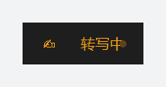
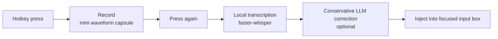
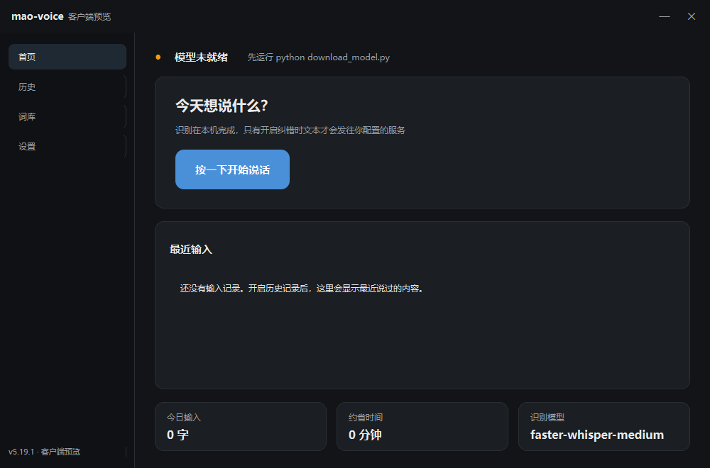
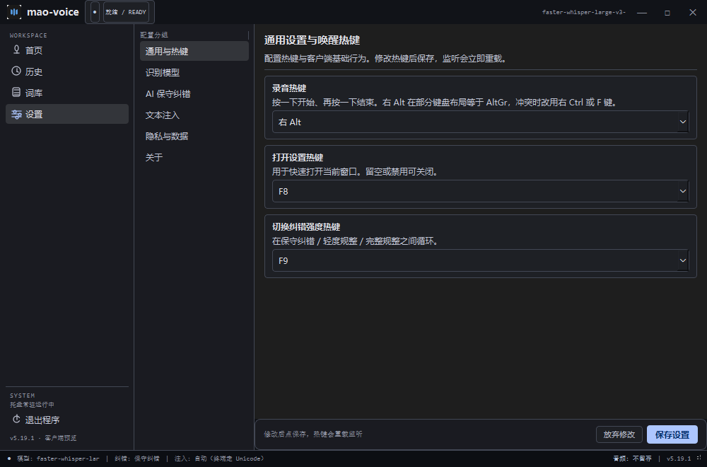

<h1 align="center">mao-voice · AI Voice Input</h1>

<p align="center">
  <a href="./README.md">简体中文</a> | <b>English</b>
  <br><br>
  <a href="https://github.com/ChenChen913/mao-voice/actions/workflows/ci.yml"></a>
  <a href="https://github.com/ChenChen913/mao-voice/releases"></a>
  <a href="LICENSE"></a>
</p>

<p align="center">Press a hotkey once to start recording, press again to finish: local Whisper transcription plus conservative LLM correction, with the clean text injected straight into the focused input box. A Windows desktop tool.</p>

> [!NOTE]
> This project is developed with AI assistance (multi-agent implementation, reviewed by multiple rounds of automated code review and three rounds of human spot-checks). The main logic is verified, but **full boundary testing has not been done**. See "Known Limitations" below. Issues are welcome — please keep in mind this is an experimental project.

## Demo

Real running UI (not mockups): only the waveform shows while recording; after you stop it shows "transcribing → injecting" and the text lands at the cursor.

| Recording | Transcribing | Injecting |
| --- | --- | --- |
|  |  |  |



## Table of Contents

- [Why this project exists](#why-this-project-exists)
- [How it differs](#how-it-differs)
- [Client preview (work in progress)](#client-preview-work-in-progress)
- [Quick Start](#quick-start)
- [Usage](#usage)
- [Configuration](#configuration)
- [Project Structure](#project-structure)
- [Development](#development)
- [FAQ](#faq)
- [Known Limitations](#known-limitations)
- [Contributing](#contributing)
- [License and redistribution](#license-and-redistribution)

## Why this project exists

Speaking is faster than typing, but the output of existing voice-input tools usually needs manual cleanup afterwards: filler words, punctuation, and homophone errors (such as "配森" for Python).

This project takes a different approach (motivation and trade-offs come from the [PRD](docs/PRD_AI语音输入法.md) and the [research doc](docs/AI语音输入法_调研与产品设计.md)):

- **Recognition runs locally**: faster-whisper transcribes offline with GPU acceleration and works without internet
- **Conservative correction**: only fixes obvious recognition errors (filler words / punctuation / homophone terms) without rewriting meaning; three strength levels
- **Safe injection**: backs up every clipboard format before injecting and restores it afterwards, pre-checks UIPI, detects external modification; terminal windows automatically switch to Unicode injection
- **Self-learning corrections**: optional. Recurring "wrong→right" pairs from the correction step are consolidated into rules that feed future prompts

**Privacy boundary (precise version)**:

- Recording and speech recognition happen entirely on your machine; **audio is never uploaded**;
- Only when correction is enabled (an API key is configured) is the **transcribed text** sent to the OpenAI-compatible endpoint you configure (DeepSeek by default);
- With no key it is fully local and offline; input history and learned rules are off by default and stored as plaintext when enabled (the settings page warns about it).

## How it differs

Up front: this is neither the most feature-complete nor the most accurate option. Its differentiator is a **careful injection path** and **tunability**.

| Option | Form | Recognition | Interaction / insertion | Differences |
| --- | --- | --- | --- | --- |
| **mao-voice** | Windows desktop tool | Local faster-whisper (GPU/CPU fallback) | Toggle hotkey; clipboard injection + terminal Unicode typing | This repo |
| [CapsWriter-Offline](https://github.com/HaujetZhao/CapsWriter-Offline) | Windows desktop tool (7k+ stars) | Local FunASR | Hold CapsLock, release to insert; hotwords + LLM polish | More mature with a bigger community; this project uses toggle, conservative correction levels, injection safety and self-learned rules |
| iFlytek / Sogou input methods | Cross-platform IME | Mostly cloud | Voice inside the IME | Zero setup and strong accuracy; requires installing an IME and uploads audio |
| Zhipu / Doubao / Typeless AI input | Desktop/mobile AI input | Cloud | Transcription + LLM polish | Complete experience but tied to a subscription and network; this project is offline-capable with swappable models and APIs |

## Client preview (work in progress)

Besides the tray-and-hotkey app, the repo now includes a PySide6 client shell: a main window (Home / History / Dictionary / Settings), the floating capsule and a tray icon, all reusing the existing engine.

| Home | Settings |
| --- | --- |
|  |  |

```powershell
cd voice_ime
python client_main.py     # or double-click 启动客户端.bat
```

Current state: the main window, tray, capsule and recording pipeline are wired up; Settings can be saved and applied immediately (hotkeys are reloaded), and History refreshes after every injection. Dictionary and per-app modes are still skeletons. The Tk `main.py` remains the stable entry point. Both share `config.json`, so do not run them at the same time.

## Quick Start

### Option 1: Prebuilt package (for users who just want to type)

Download `mao-voice-windows-x64.zip` from [Releases](https://github.com/ChenChen913/mao-voice/releases) (CPU build, built by CI), then:

1. Put a `faster-whisper-small` or `medium` model folder into `models/` next to the exe (models are too large to bundle);
2. Double-click `mao-voice.exe`; the first run creates `config.json`;
3. Fill `refine.api_key` in `config.json` (optional) or set the `DEEPSEEK_API_KEY` environment variable;
4. Press right Alt and speak.

### Option 2: Run from source (development / customization)

Requirements: Windows 10/11, Python 3.10+ (CI tests 3.12/3.13), a microphone; optional NVIDIA GPU with CUDA runtime.

```powershell
git clone https://github.com/ChenChen913/mao-voice.git
cd mao-voice/voice_ime
pip install -r requirements.txt
python download_model.py                # medium ~1.5 GB, small ~464 MB
python doctor.py                        # environment self-check; run once all ✅
python main.py                          # or double-click 启动.bat
```

> `config.json` is generated on first run (equivalent to `copy config.example.json config.json`). Models download from ModelScope (reachable from China), or use `python download_model.py --model small`. Full deployment and GPU setup: [部署文档](docs/部署文档.md) (Chinese).

## Usage

1. Open any window that accepts text (Notepad, chat box, document)
2. **Press the hotkey once** (right Alt by default) to start recording — a mini waveform capsule appears at the bottom center without stealing focus
3. **Press it again** to finish — it shows "transcribing → injecting" and inserts the text at the cursor
4. Quit: right-click the capsule → Exit, or use the tray icon

Other controls: `F8` opens settings (hotkeys / model / LLM / glossary / history), `F9` cycles correction strength, the tray icon shows the current state.

Prefer not to install Python? `python packaging/build_exe.py` builds a portable exe (see [部署文档 §5.9](docs/部署文档.md), Chinese).

## Configuration

The config file is `voice_ime/config.json` (created on first run, written atomically). Common keys:

| Key | Required | Default | Description |
|---------|----------|---------|-------------|
| `refine.api_key` | No | empty | DeepSeek or any OpenAI-compatible API key. **Pay per use**; empty = skip correction and output raw transcription |
| `hotkey` | No | `alt_r` | Toggle hotkey: `alt_r`/`ctrl_r`/`f1`~`f12`/`caps_lock` etc. |
| `asr.model` | No | `models/faster-whisper-medium` | Local model path |
| `asr.language` | No | `null` | `null` = auto detect (good for mixed Chinese/English), `"zh"` = force Chinese |
| `refine.level` | No | `conservative` | Correction strength: `conservative`/`light`/`polish` |
| `inject.paste_mode` | No | `auto` | In `auto`, terminal-like windows switch to Unicode injection; can force `ctrl_v`/`unicode` |
| `history.enabled` / `learn.enabled` | No | `false` | Input history / self-learning. Both are stored as **plaintext** and off by default |

Environment variables (config.py): `DEEPSEEK_API_KEY` (correction key fallback), `ASR_API_KEY` (cloud ASR key fallback).

Glossary `voice_ime/词库.txt`: one term per line, or `wrong=preferred` (e.g. `配森=Python`); it feeds both recognition and correction prompts.

Full configuration reference: [部署文档 §5.4](docs/部署文档.md) (Chinese).

## Project Structure

```text
mao-voice/
├── voice_ime/            # Runtime code: 24 Python modules, ~5,300 lines
│   ├── main.py           # Tk entry: recording state machine + pipeline
│   ├── client_main.py    # Qt client entry (preview)
│   ├── qt_ui/            # Main window / capsule / tray / engine adapter
│   ├── asr.py            # faster-whisper engine (GPU first, CPU fallback)
│   ├── safe_inject.py    # Clipboard injection + Unicode typing
│   ├── learn.py          # Self-learned correction rules
│   ├── version.py        # Single source of the version number
│   ├── models/           # Local models (not committed)
│   └── tests/            # pytest suite (128 tests) + live smoke scripts
├── packaging/            # PyInstaller build script and icon
├── docs/                 # Deployment guide, PRD/SPEC/research, audits, demo images
└── .github/workflows/    # CI tests + tag-triggered packaging/release
```

## Development

```powershell
python -m pytest voice_ime/tests -q     # run tests (130 passed on 2026-11-01)
python -m ruff check voice_ime          # lint (same as CI)
python -m compileall -q voice_ime       # syntax check
python voice_ime/tests/e2e_live.py --no-asr   # live smoke: injection + clipboard restore (no model needed)
python voice_ime/tests/e2e_live.py      # full live smoke: TTS → local ASR → injection (model required)
python voice_ime/tests/client_smoke.py  # Qt client + engine smoke (fake recording/injection)
python voice_ime/client_main.py         # launch the Qt client (preview)
python packaging/build_exe.py           # build the Tk exe
python packaging/build_exe.py --client  # build the Qt client exe (preview)
```

- Pushing runs the test CI (Windows + Python 3.12/3.13); a `v*` tag builds and publishes a Release
- Review history: [OCR audit](docs/audits/OCR审查报告.md), [project audit](docs/audits/项目审核报告.md), [third-round audit](docs/audits/深度审核报告_第三轮_2026-09-28.md) (Chinese)
- Full version history: [changelog](docs/更新记录.md) (Chinese)

## FAQ

**Q: "API key not configured"?**
A: Put `refine.api_key` into `voice_ime/config.json` or set `DEEPSEEK_API_KEY`. It also works without a key (raw transcription, no cost).

**Q: "Model failed to load"?**
A: Run `python download_model.py` first, then `python doctor.py` to confirm the model path.

**Q: Injection failed / no text appeared?**
A: A target window running as administrator is blocked by UIPI; the text is already on the clipboard, paste it manually. For terminals (CMD/Git Bash) the app automatically switches to Unicode injection.

**Q: Right Alt does nothing, or types an odd character?**
A: On some non-Chinese keyboard layouts right Alt is AltGr (used for special characters) and conflicts with the hotkey. Change the hotkey to right Ctrl or an F key in the settings window.

**Q: `python` is not recognized?**
A: Python was installed without "Add Python to PATH"; reinstall and check that option.

More troubleshooting: [部署文档 FAQ](docs/部署文档.md) (Chinese).

## Known Limitations

- Windows only; a macOS version is on the roadmap (see the Swift plan in [docs/提示词.txt](docs/提示词.txt)) but not implemented
- Cloud ASR fallback (`cloud_asr.py`) exists but has never been tested against a real endpoint
- Injection into administrator windows is blocked by UIPI (pre-check warning + clipboard fallback)
- Input history and learned rules are plaintext on disk (both off by default, warned in settings)
- Entire audio stays in memory: very long recordings (300 s default cap) grow linearly
- UI and messages are Chinese-only; the packaged build is only smoke-tested for "process survives" in CI, GPU loading is not verified there
- Client preview: Dictionary and per-app modes are still read-only skeletons; the Tk app and Qt client share the same config, so do not run both

## Contributing

Issues about problems and edge cases are welcome at [Issues](https://github.com/ChenChen913/mao-voice/issues). Before a PR:

```powershell
python -m pytest voice_ime/tests -q
python -m ruff check voice_ime
```

This is an experimental project, so responses may be slow.

## License and redistribution

[Apache-2.0](LICENSE)

The CPU release package contains no NVIDIA components. If you build the GPU version locally and redistribute it, the bundle includes cuBLAS/cuDNN runtime libraries — comply with the corresponding NVIDIA redistribution terms, or use `python packaging/build_exe.py --cpu-only` to avoid them.
